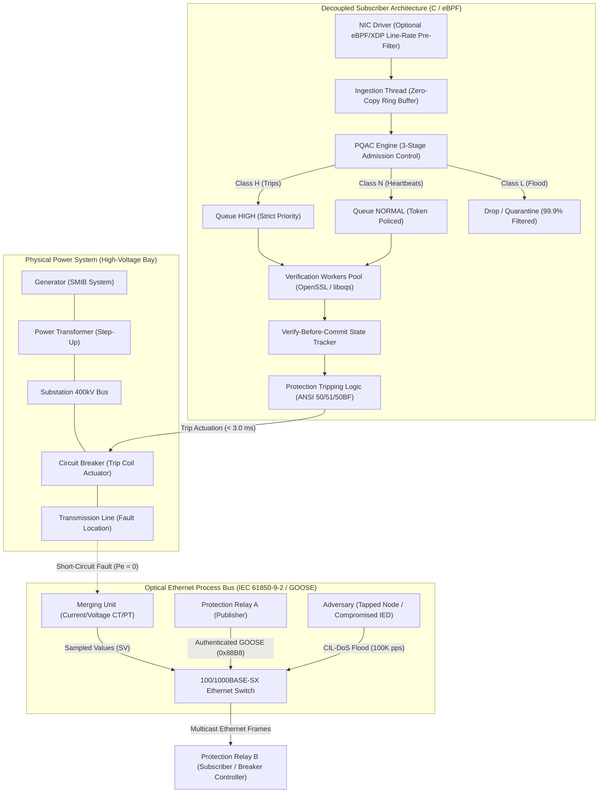
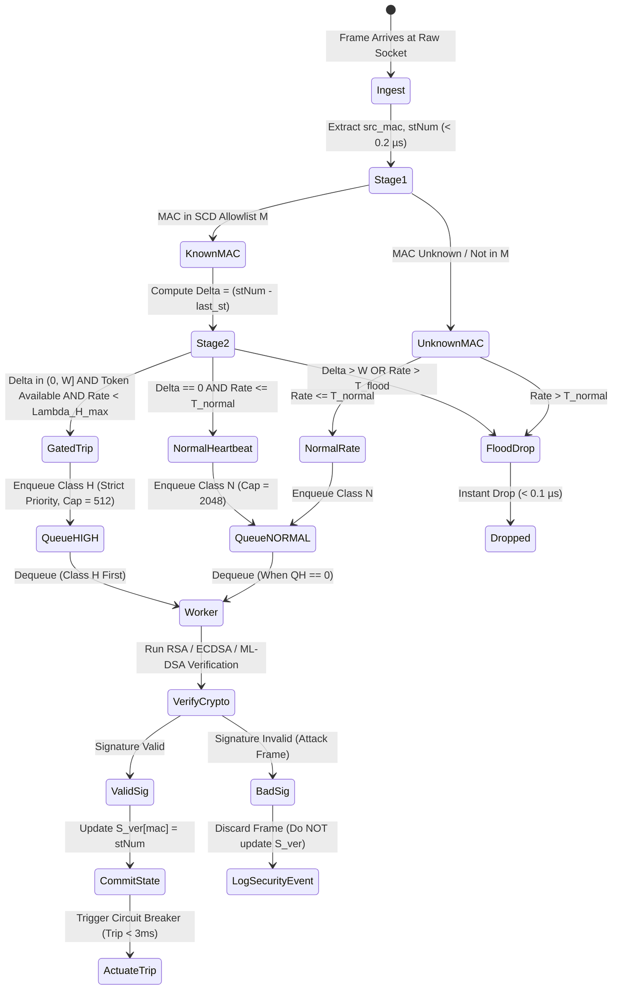
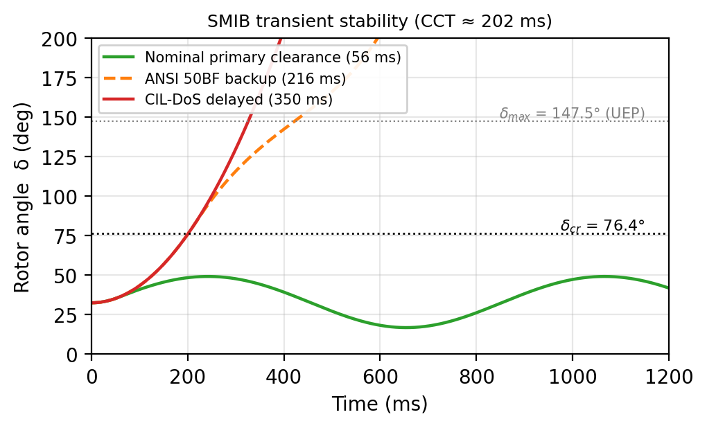
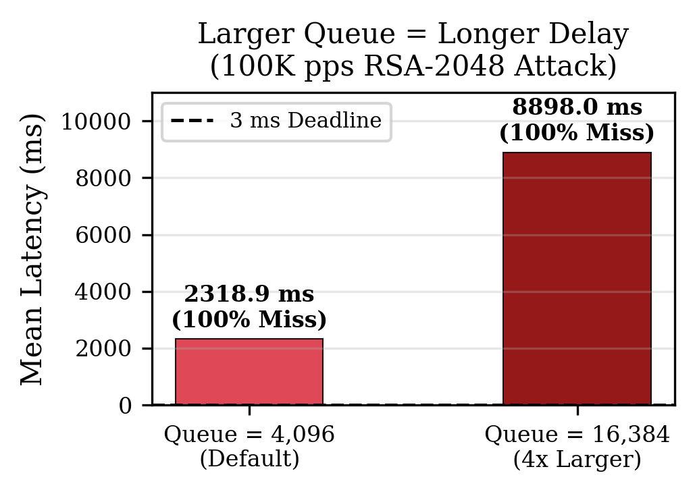
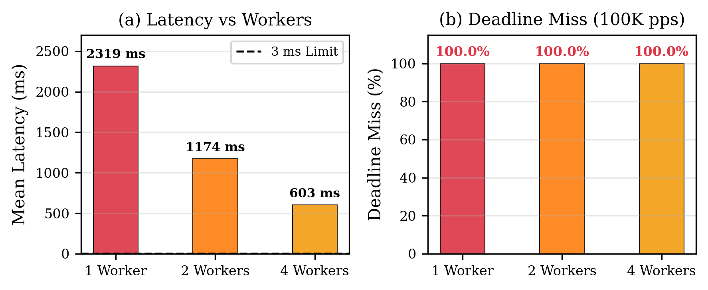
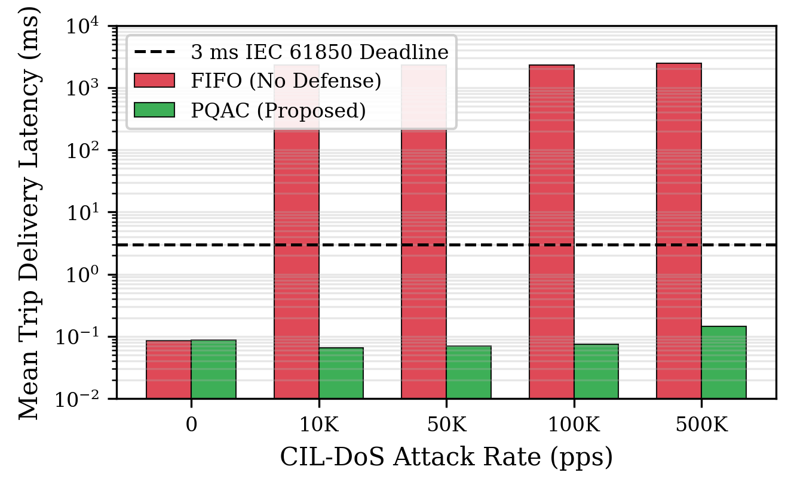
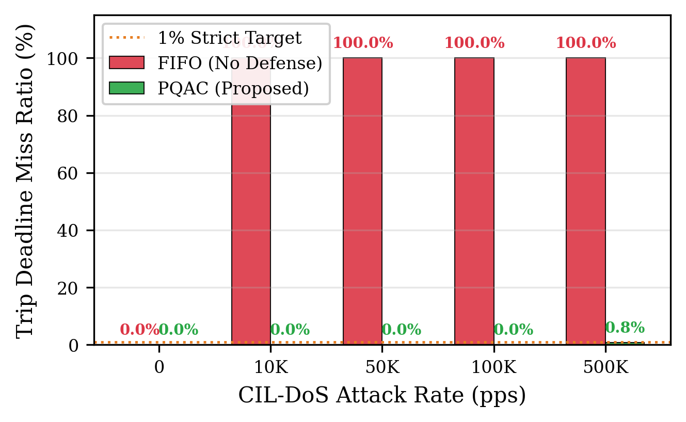

# GridPulse ⚡
### Breaking Smart Grid Protection via IEC 62351 Cryptographic Exhaustion (CIL-DoS)

[-blueviolet.svg)](paper/main_tsg.pdf)
[](LICENSE)
[](pyproject.toml)
[](gridpulse/hardware/)
[](gridpulse/hardware/docker-compose.yml)
[](gridpulse/hardware/esp32_crypto_bench/)

> **GridPulse** is an open-source cybersecurity and power-system research toolkit demonstrating **Crypto-Induced Latency Denial of Service (CIL-DoS)** in IEC 61850 / IEC 62351 digital substations. It models the cyber-to-physical failure chain (generator rotor angle instability and transformer thermal stress), provides real embedded silicon benchmarks (Arduino / ESP32), benchmarks NIST Post-Quantum Cryptography (PQC), and deploys the **Priority Queue Admission Controller (PQAC)** defense.
>
> 📄 **Research Paper:** *Crypto-Induced Latency Denial of Service in IEC 61850 Substation Communications: Cyber-Physical Impact Analysis, Priority Admission Defense, and Post-Quantum Evaluation*  
> 🏛️ **Affiliation:** Department of Computer Science and Engineering, PES University, Bengaluru, India  
> 📬 **Status:** Submitted and **Under Review** in *IEEE Transactions on Smart Grid* (Submitted October 7, 2026).

⚠️ **Notice:** This repository is published strictly for authorized academic security research, defensive testing, and utility engineering validation.

---

## 📌 The Security-Safety Paradox: What is CIL-DoS?

Modern electrical substations replace copper wiring with Ethernet process buses where time-critical protection signals (circuit breaker trip commands) are transmitted via **IEC 61850 GOOSE** multicast messages with a strict **3.0 millisecond (ms)** real-time delivery deadline (Performance Class P2/P3).

To prevent packet spoofing and tampering, **IEC 62351-6** specifies cryptographic authentication profiles (digital signatures like RSA-2048, ECDSA-P256, and symmetric MACs). However, digital signature verification is computationally heavy and executed sequentially on resource-constrained Intelligent Electronic Device (IED) processors:

```
[Attacker on Process Bus] 
       │ Floods syntactically valid but cryptographically invalid GOOSE frames (10K–100K pps)
       ▼
[Receiver IED Verification Queue]
       │ Accepts frames at wire speed; CPU must execute full modular math to reject each frame
       │ Queue saturates immediately (ρ >> 1) → Buffer Bloat delay reaches 2,388 ms
       ▼
[Legitimate Fault Trip Command]
       │ Stuck behind thousands of invalid frames in queue
       │ Misses the 3.0 ms IEC 61850 safety deadline (100% violation rate)
       ▼
[Physical Power Grid Consequences]
       ├── Generator Rotor Angle Divergence past Critical Clearing Time (tcrit ≈ 201.6 ms)
       ├── ANSI 50BF Breaker Failure protection blinded (retrip messages delayed on same bus)
       └── 6.25× Surge in Transformer Through-Fault Thermal Energy (I²t) → Winding Flashover
```

---

## 🏗️ System Architecture & Cyber-Physical Pipeline

For in-depth mathematical formulations, state machine proofs, and hardware wiring diagrams, see our full technical document:  
👉 **[Full Architecture Specification (`docs/ARCHITECTURE.md`)](docs/ARCHITECTURE.md)**

### End-to-End Cyber-Physical Architecture



### Decoupled Two-Thread Pipeline & PQAC State Machine



---

## 🔬 Key Empirical Discoveries

### 1. Real Silicon Validation (Arduino / ESP32 Hardware)
To eliminate reliance on synthetic desktop simulations, cryptographic operations were measured directly on real embedded silicon (**ESP32-D0WDQ6**, Xtensa LX6 @ 240 MHz dual-core, programmed via Arduino IDE using hardware-accelerated mbedTLS).

```
======================================================================================
  Algorithm       Operation     Payload       Measured Latency     Grid Safety Status
======================================================================================
  HMAC-SHA256     Verify        350 B             167.3 µs        ✅ Sub-millisecond
  AES-128-GCM     Verify        350 B             228.7 µs        ✅ Sub-millisecond
  RSA-2048        Verify        32 B              980.1 µs        ⚠️ Saturated @ 1K pps
  RSA-2048        Sign          32 B          181,518.1 µs (181 ms)  ❌ Fails IEC 61850 bursts
  ECDSA-P256      Verify        32 B          310,475.9 µs (310 ms)  🚨 103× PAST 3ms DEADLINE!
  ECDSA-P256      Sign          32 B          156,932.9 µs (157 ms)  ❌ 52× past trip window
======================================================================================
```
* **Discovery:** A single software ECDSA-P256 verification on embedded silicon takes **310.5 ms**, which inherently violates the 3.0 ms safety deadline by **over 100×** without any attack taking place!

### 2. Physical Grid Collapse Dynamics (SMIB Simulation)
<p align="center">
  
</p>

* **Equal-Area Criterion Derivation:** For a 3-phase bolted fault ($P_e = 0$), Critical Clearing Time is $t_{\text{crit}} \approx 201.6$\,ms under base inertia ($H=5.0$\,s, $P_m=0.8$\,p.u.), dropping to $\approx 120$\,ms in low-inertia renewable grids ($H=2.5$\,s, $P_m=0.95$\,p.u.).
* **Transformer Damage:** Under delayed backup clearing (350 ms), transformer through-fault thermal energy surges by **6.25× ($I^2 t$)** under IEEE Std C57.109-2018, causing severe 120 Hz Lorentz mechanical winding deformation.

### 3. NIST Post-Quantum Cryptography (PQC) Evaluation
We benchmarked official NIST quantum-resistant standards (**FIPS 204 ML-DSA** and **FIPS 205 SLH-DSA**, plus FALCON-512):
* **The SLH-DSA Bottleneck:** Hash-based SLH-DSA-SHA2-128s takes **295.4–597.4 ms** to sign at the publisher (violating the 3 ms deadline at the source) and generates a **7,856-byte signature** that requires 9 kB jumbo frames which standard substation Ethernet switches discard.
* **Lattice Signatures:** Lattice-based ML-DSA-44 and FALCON-512 achieve sub-millisecond execution and are effectively shielded by PQAC admission control.

### 4. Failure of Naïve Countermeasures
<p align="center">
  
  
</p>

* **Buffer Bloat:** Expanding queue capacity from 4,096 to 16,384 frames inflates queueing latency from 2,388 ms to 8,898 ms ($4\times$ worse) while maintaining 100% deadline violations.
* **Parallel Worker Threads:** Deploying 4 verification threads increases throughput, but an adversary flooding at 100K pps still maintains $\rho_4 = 14.3 \gg 1$, resulting in 100% deadline failure.

---

## 🛡️ The Defense: Priority Queue Admission Controller (PQAC)

<p align="center">
  
  
</p>

PQAC sits between the network interface and cryptographic verification workers, executing $O(1)$ triage in $<0.2\,\mu$s per frame:
1. **Stage 1 (MAC Allowlist):** Cross-references source MAC against pre-provisioned Substation Configuration Description (SCD) allowlists.
2. **Stage 2 (RFC 1982 Serial Arithmetic & Transition Gating):** Evaluates state transitions ($\Delta = F.\text{stNum} \ominus \text{last\_verified\_st}$) within a bounded plausibility window ($W=16$), gated by a transition token bucket ($B_{\text{trans}}$).
3. **Stage 3 (Verify-Before-Commit):** Trusted state counter $S_{\text{ver}}[\text{mac}]$ is updated **only after successful signature verification**, preventing state poisoning and trip suppression attacks.
4. **Results:** Achieves up to **$3,140\times$ latency reduction** on Cortex-A9 relay profiles (2,388 ms $\to$ 760 $\mu$s, **0.00% deadline miss** across 49 controlled experiments).

---

## 📂 Repository Structure

```
GridPulse/
├── gridpulse/                  # Python framework & testbed
│   ├── protocols/              # IEC 61850 GOOSE ASN.1 BER parser + IEC 62351 crypto
│   ├── attacks/                # CIL-DoS flood generators, MAC spoofing, burst curves
│   ├── defense/                # eBPF/XDP filter, loader, and statistics
│   ├── ids/                    # Stateful GOOSE IDS mapped to MITRE ATT&CK for ICS
│   ├── bench/                  # Multi-trial benchmarks, M/M/1 & M/D/1 queueing models
│   ├── testbed/                # Software IEC 61850 substation bus & relay emulation
│   ├── demo/                   # Scripted live demonstration & terminal dashboard
│   ├── hardware/               # Native C hardware testbed & Docker configurations
│   │   ├── goose_subscriber.c  # Decoupled 2-thread subscriber with PQAC & FIFO
│   │   ├── goose_attacker.c    # Line-rate raw Ethernet CIL-DoS flood injector
│   │   ├── goose_publisher.c   # IEC 61850 burst retransmission publisher
│   │   ├── xdp_goose_filter.c  # Kernel eBPF/XDP wire-speed filter
│   │   ├── docker-compose.yml  # Multi-container process bus testbed (MTU 9000)
│   │   └── esp32_crypto_bench/ # Arduino sketch for physical silicon benchmarking
│   └── cli/                    # Click-based CLI with 12 subcommands
├── docs/                       # Technical architecture & threat models
│   ├── ARCHITECTURE.md         # Full mathematical formulations, proofs, and wiring
│   ├── THREAT_MODEL.md         # Process bus adversary capabilities & boundaries
│   ├── LESSONS_FOR_DEFENDERS.md# Operational recommendations for substation engineers
│   └── figures/                # Publication-quality architectural diagrams & plots
├── paper/                      # IEEE Transactions on Smart Grid manuscript & figures
├── results/                    # CSV datasets from 49 controlled experiments & silicon tests
├── tests/                      # Pytest test suite (17 passed)
├── CITATION.cff                # Citation metadata
├── LICENSE                     # MIT License
└── pyproject.toml              # Build & dependency specifications
```

---

## 🚀 Quick Start Guide

### 1. Python Environment Setup
```bash
# Clone the repository
git clone https://github.com/sapnadfir-blip/gridpulse.git
cd gridpulse

# Create and activate virtual environment
python3 -m venv .venv
source .venv/bin/activate

# Install in editable mode
pip install -e .

# Run test suite
pytest tests/
```

### 2. Run the Live Interactive Demo Dashboard
Launch the terminal visualization showing baseline, CIL-DoS flood onset (latency climbing past 50 ms), and instant PQAC/XDP recovery:
```bash
gridpulse demo --profile mid_range
```

### 3. Native Docker Process Bus Testbed (100K pps CIL-DoS)
Run the isolated multi-container Layer-2 testbed evaluating PQAC vs. FIFO under flood:
```bash
cd gridpulse/hardware

# Build container images
docker compose build

# Run 100K pps RSA-2048 attack with PQAC defense enabled
docker compose run --rm subscriber --mode priority --attack-rate 100000 --duration 25

# Run baseline unmitigated FIFO queue (observes 2.3s latency)
docker compose run --rm subscriber --mode fifo --attack-rate 100000 --duration 25
```

### 4. Flash & Run Arduino / ESP32 Silicon Benchmarks
1. Open `gridpulse/hardware/esp32_crypto_bench/esp32_crypto_bench.ino` in the Arduino IDE.
2. Select your ESP32 board (e.g., `ESP32 Dev Module`).
3. Set CPU Frequency to 240 MHz.
4. Upload and open the Serial Monitor at 115200 baud to view real-time cryptographic verification timings.

---

## 📄 Academic Research Paper

This work is detailed in our manuscript submitted to the **IEEE Transactions on Smart Grid**:

> **Title:** *Crypto-Induced Latency Denial of Service in IEC 61850 Substation Communications: Cyber-Physical Impact Analysis, Priority Admission Defense, and Post-Quantum Evaluation*  
> **Authors:** Sapna Vikram Mewundi, Prajwal Chowdary M., Prasad B. Honnavalli  
> **Affiliation:** Department of Computer Science and Engineering, PES University, Bengaluru, India  
> **Correspondence:** sapnavm@pes.edu  
> **Status:** **Under Review in IEEE Transactions on Smart Grid (Submitted October 7, 2026)**

### Citation (BibTeX)
```bibtex
@article{mewundi2026cildos,
  author={Mewundi, Sapna Vikram and Chowdary M., Prajwal and Honnavalli, Prasad B.},
  journal={IEEE Transactions on Smart Grid},
  title={Crypto-Induced Latency Denial of Service in {IEC} 61850 Substation Communications: Cyber-Physical Impact Analysis, Priority Admission Defense, and Post-Quantum Evaluation},
  year={2026},
  note={Under review (Submitted October 7, 2026)}
}
```

---

## ⚖️ License
This project is licensed under the MIT License — see the [LICENSE](LICENSE) file for details.
