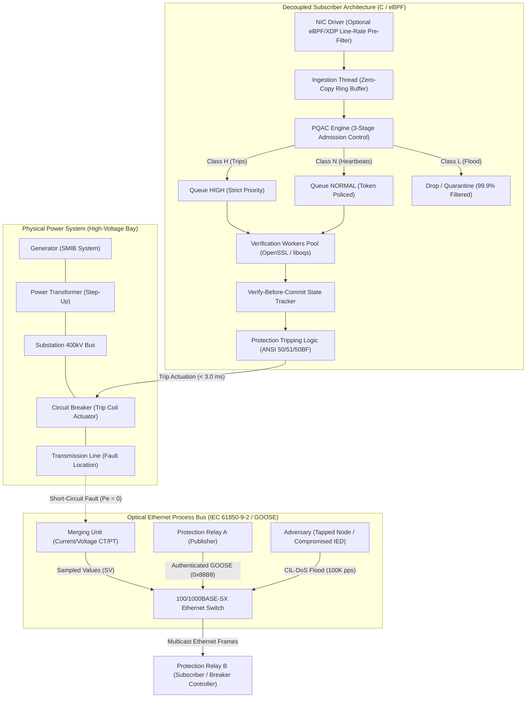
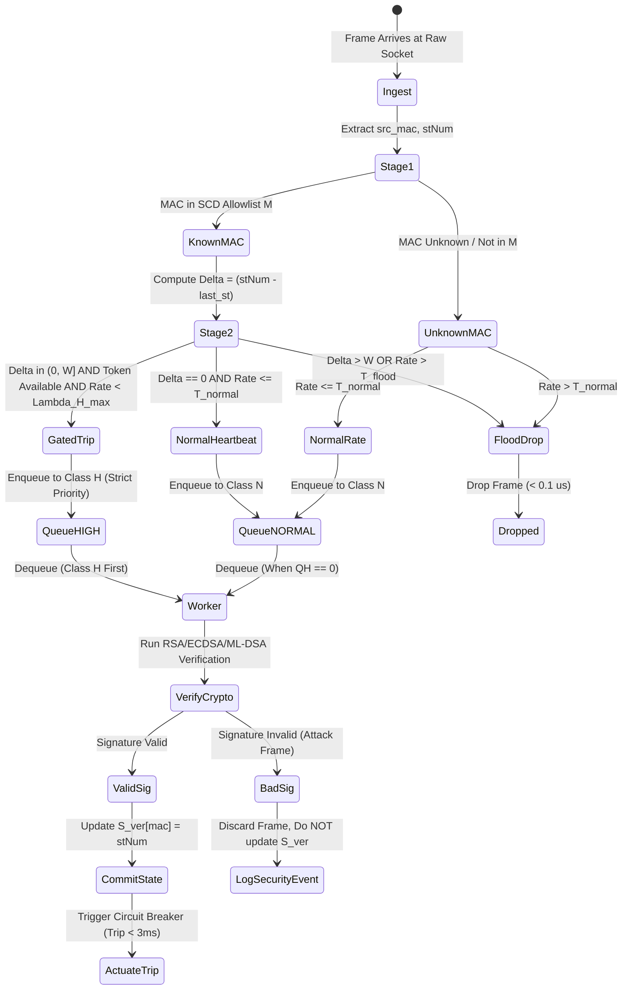

# GridPulse Architecture and Cyber-Physical Systems Specification

> **Technical Reference & Systems Architecture**  
> **Target System:** IEC 61850 / IEC 62351 Substation Automation Systems  
> **Associated Manuscript:** *Crypto-Induced Latency Denial of Service in IEC 61850 Substation Communications: Cyber-Physical Impact Analysis, Priority Admission Defense, and Post-Quantum Evaluation*  
> **Status:** *Under Review in IEEE Transactions on Smart Grid (Submitted October 7, 2026)*

---

## 1. High-Level Cyber-Physical Substation Architecture

The diagram below illustrates the end-to-end architecture of a modern digital substation process bus, showing the interaction between the physical power grid, the optical Layer 2 Ethernet process bus, the adversary's CIL-DoS injection, the IED receiver pipeline, and physical protection actuators.



---

## 2. Decoupled Two-Thread Subscriber Architecture

Traditional substation IED software processes incoming Ethernet frames in a single serialized thread: frame reception, parsing, signature verification, state tracking, and tripping logic occur synchronously. Under a CIL-DoS flood, this causes immediate buffer overflow and kernel socket drops.

GridPulse introduces a **decoupled two-thread architecture** implemented in native C (`goose_subscriber.c`):

```
+-----------------------------------------------------------------------------------------+
|                                    DECOUPLED IED PIPELINE                               |
+-----------------------------------------------------------------------------------------+
                                                                                           
 [Raw Ethernet Socket]                                                                    
         │  Layer 2 Frames (EtherType 0x88B8)                                              
         ▼                                                                                 
 +---------------------------------------------------------------------------------------+ 
 | INGESTION THREAD (Runs at Wire Speed > 500,000 pps)                                   | 
 |                                                                                       | 
 |  1. Parse Ethernet Header (src_mac, dst_mac, EtherType)                               | 
 |  2. Quick GOOSE Header Peek (stNum, sqNum, appID) in < 0.2 µs                         | 
 |  3. PQAC Admission Triage (Stage 1 Allowlist -> Stage 2 RFC 1982 Serial Gating)       | 
 |  4. Enqueue to designated priority ring buffer (HIGH, NORMAL, or DROP)                | 
 +---------------------------------------------------------------------------------------+ 
         │                                                                                 
         ├── Class H (Trips)       ──> [Queue HIGH   (Ring Buffer, Cap = 512)]             
         ├── Class N (Heartbeats)  ──> [Queue NORMAL (Ring Buffer, Cap = 2048)]            
         └── Class L (Floods)      ──> [INSTANT DROP (< 0.1 µs overhead)]                  
                                                     │                                     
                                                     ▼                                     
 +---------------------------------------------------------------------------------------+ 
 | VERIFICATION WORKER THREAD(S) (Serialized Cryptographic Execution)                    | 
 |                                                                                       | 
 |  1. Priority Dequeue: Strict priority (Class H processed whenever QH > 0)             | 
 |  2. Cryptographic Signature Verification (RSA-2048, ECDSA-P256, ML-DSA-44)           | 
 |  3. Verify-Before-Commit: State counter S_ver[mac] updated ONLY upon signature validity| 
 |  4. Execute Protection Logic (< 50 µs): Actuate Circuit Breaker Trip Coil              | 
 +---------------------------------------------------------------------------------------+ 
         │                                                                                 
         ▼                                                                                 
 [Physical Trip Actuation: Circuit Breaker Opens in < 3.0 ms]                              
```

---

## 3. Priority Queue Admission Controller (PQAC)

PQAC is the mathematical admission control core that prevents queue collapse. It operates in three stages:

### Stage 1: $O(1)$ MAC and Bay Allowlisting
Incoming frames are checked against a pre-provisioned Substation Configuration Description (SCD) allowlist table $\mathcal{M}$:
* Pre-configured at substation commissioning time.
* Unknown MAC addresses are immediately relegated to Class $N$ or dropped during high network traffic.

### Stage 2: RFC 1982 Serial Number Arithmetic and Plausibility Gating
To prevent an attacker from sending monotonically increasing fake `stNum` counters to spoof high-priority trips, PQAC computes the modular sequence distance:
$$\Delta = (F.\text{stNum} \ominus \text{last\_verified\_st})$$
* **Plausibility Window:** The frame is admitted to Class $H$ if and only if $\Delta \in (0, W]$ (where $W=16$).
* **Rollover Protection:** RFC 1982 serial arithmetic handles $2^{32}-1$ integer wrap-around cleanly.
* **Transition Token Bucket ($B_{\text{trans}}$):** State transitions are rate-limited to 5 per second per publisher, preventing transition flood saturation.

### Stage 3: Verify-Before-Commit State Protection
* **Vulnerability in Naïve Relays:** Updating relay state before verification allows an attacker to send one packet with $\text{stNum} = \max$, permanently poisoning the state and suppressing all future legitimate trips.
* **PQAC Solution:** The trusted state variable $S_{\text{ver}}[\text{mac}]$ is updated **strictly after** full mathematical verification of the signature succeeds.



### Mathematical Proofs Summary
* **Theorem 1 (Queue Stability):** With an aggregate Class $H$ cap $\Lambda_H^{\max} \le 500$\,pps, the high-priority protection queue is unconditionally stable ($\rho_H < 1$) across all attack rates:
  $$\rho_H = \frac{\lambda_H}{\mu} \le \frac{\Lambda_H^{\max}}{\mu} = \frac{500}{1,745} \approx 0.286 < 1 \quad \text{(ARM Cortex-A9 relay)}$$
* **Theorem 3 (Worst-Case Trip Latency Bound):** For an admitted trip frame arriving during steady-state CIL-DoS flood with $Q_H = 0$:
  $$T_{\text{trip}} \le t_{\text{ingest}} + S_{\max} + \overline{S} + t_{\text{logic}} \le 1\,\mu\text{s} + 573\,\mu\text{s} + 573\,\mu\text{s} + 50\,\mu\text{s} = 1{,}197\,\mu\text{s} \approx 1.20\,\text{ms} < 3.0\,\text{ms}$$

---

## 4. Cyber-Physical Power System Failure Model

To quantify the real-world consequence of a missed 3.0 ms communication deadline, GridPulse models a Single-Machine Infinite-Bus (SMIB) transmission network governed by the non-linear swing equation:

$$\frac{2H}{\omega_s} \frac{d^2 \delta}{dt^2} = P_m - P_{\max} \sin \delta$$

```
========================================================================================
  TIMELINE OF PHYSICAL POWER GRID COLLAPSE UNDER CIL-DoS ATTACK
========================================================================================

  t = 0.0 ms      Short-circuit fault occurs on 400kV transmission line (Pe = 0)
                  Generator rotor accelerates at alpha = 1,080 deg/s²
                  Relay A detects overcurrent and emits GOOSE Trip message
                  
  t = 3.0 ms      IEC 61850 CLASS P2/P3 DEADLINE
                  [NORMAL STATE]: Breaker trips, fault cleared in 50-80 ms.
                  [CIL-DoS ATTACK]: Process bus flooded; Trip message stuck in queue!
                  
  t = 50.0 ms     Breaker mechanism should have opened. Fault remains energized.
                  Rotor angle advances: delta(t) = delta_0 + 0.5 * alpha * t²
                  
  t = 120.3 ms    CRITICAL CLEARING TIME (Low-Inertia Renewable Grid, H = 2.5s)
                  Rotor angle exceeds delta_cr = 69.4°. Synchronism permanently lost!
                  
  t = 201.6 ms    CRITICAL CLEARING TIME (Base Grid, H = 5.0s, delta_cr = 76.4°)
                  Allowable angular excursion exceeded. Generator pole-slipping starts.
                  
  t = 216.0 ms    ANSI 50BF Breaker Failure timer expires; tries to retrip backup breakers.
                  50BF messages traverse the SAME flooded bus; backup path also blinded!
                  
  t = 350.0 ms    Zone 2 / Backup overcurrent trip finally clears fault.
                  Transformer I²t thermal stress reaches 6.25× design limits.
                  Lorentz force mechanical displacement causes winding failure.
                  
  t = 2,388 ms    Delayed primary trip frame finally exits saturated verification queue!
========================================================================================
```

---

## 5. Physical Silicon Microcontroller Benchmarking

To validate the timing constraints on physical embedded silicon, tests were conducted on an **ESP32-D0WDQ6** microcontroller (Xtensa LX6 @ 240 MHz dual-core) using hardware-accelerated bignum/SHA mbedTLS via Arduino:

```
+----------------------------------------------------------------------------------+
|                            ESP32 ARDUINO BENCHMARK SETUP                         |
+----------------------------------------------------------------------------------+
                                                                                    
   [PC / Host Controller]                                                           
             │ USB / Serial @ 115200 Baud                                           
             ▼                                                                      
   +------------------------------------------------------------------------------+ 
   | ESP32-D0WDQ6 Silicon (Xtensa LX6 @ 240 MHz Dual-Core)                         | 
   |                                                                              | 
   |  Firmware: esp32_crypto_bench.ino (mbedTLS)                                  | 
   |  Timing: esp_timer_get_time() high-resolution microsecond hardware counter    | 
   |                                                                              | 
   |  Measurements:                                                               | 
   |    * HMAC-SHA256 (350B):   167.3 µs                                          | 
   |    * AES-128-GCM (350B):   228.7 µs                                          | 
   |    * RSA-2048 Verify:      980.1 µs                                          | 
   |    * RSA-2048 Sign:        181,518.1 µs (181.5 ms)                           | 
   |    * ECDSA-P256 Verify:    310,475.9 µs (310.5 ms -> 103x past 3ms limit!)  | 
   |    * ECDSA-P256 Sign:      156,932.9 µs (156.9 ms)                           | 
   +------------------------------------------------------------------------------+ 
```

---

## 6. NIST Post-Quantum Cryptography Architecture

GridPulse benchmarks official NIST quantum-resistant standards (**FIPS 204 ML-DSA** and **FIPS 205 SLH-DSA**, plus FALCON-512) over 100K pps flood attacks:

| Algorithm | Cryptographic Family | Security Level | Verify Latency | Sign Latency | Signature Size | Substation Viability |
| :--- | :--- | :--- | :--- | :--- | :--- | :--- |
| **ML-DSA-44** | Lattice (Module-LWE) | NIST Level 2 | 55.9 $\mu$s | 120.4 $\mu$s | 2,420 Bytes | ✅ Viable with Jumbo Frames (MTU 9000) + PQAC |
| **ML-DSA-87** | Lattice (Module-LWE) | NIST Level 5 | 139.5 $\mu$s | 240.1 $\mu$s | 4,627 Bytes | ✅ Viable with Jumbo Frames (MTU 9000) + PQAC |
| **FALCON-512**| Lattice (NTRU) | NIST Level 1 | 24.0 $\mu$s | 380.2 $\mu$s | 666 Bytes | 🌟 **Optimal** (Fits in standard 1,500B MTU) |
| **SLH-DSA-128s**| Hash-Based (SPHINCS+) | NIST Level 1 | 260.6 $\mu$s | **295.4–597.4 ms** | **7,856 Bytes** | ❌ **UNUSABLE** (Signing lag > 100× deadline; MTU bloat) |

### Key Post-Quantum Finding
While lattice-based algorithms (ML-DSA, Falcon) verify in microseconds and survive CIL-DoS under PQAC protection, **stateless hash-based signatures (SLH-DSA, FIPS 205) are fundamentally unviable for real-time electrical grid tripping**. Generating an SLH-DSA signature requires up to 597 milliseconds, violating the 3.0 ms safety deadline at the publisher relay before the packet is even placed on the Ethernet physical wire.
